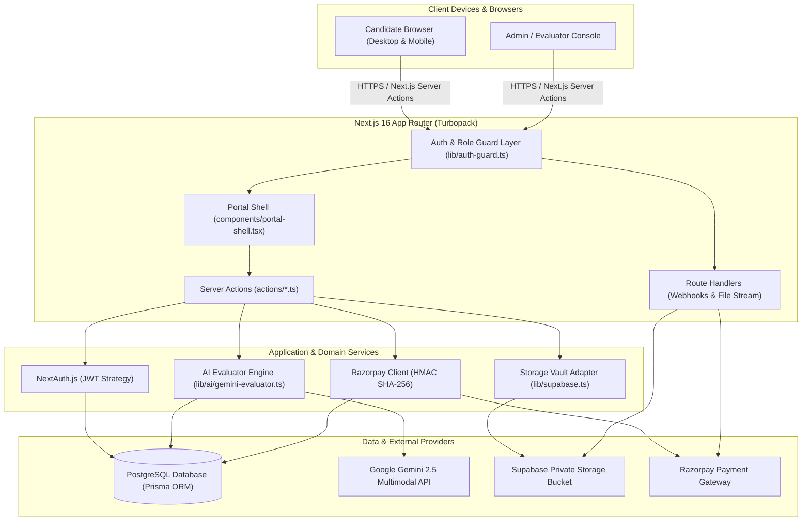
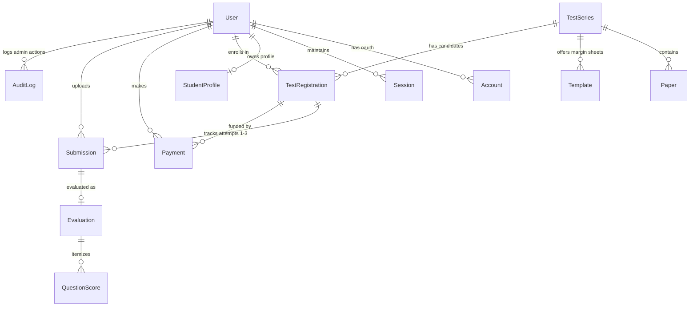
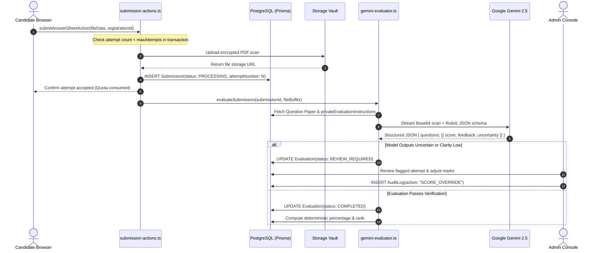
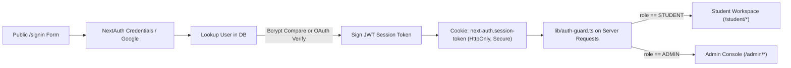
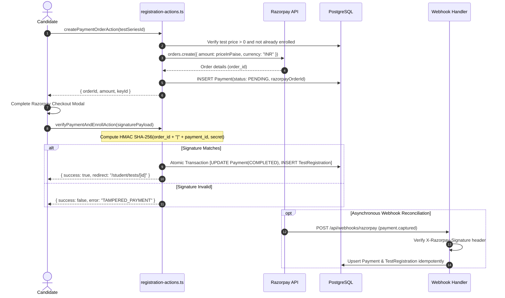

# Verityra — System Architecture & Technical Specifications

> **Scope**: Primary system architecture, data models, runtime pipelines, and security boundaries for **Verityra** (`verityra4/`).

---

## 1. Executive Summary & Architecture Philosophy

**Verityra** is a full-stack, enterprise-grade subjective test-series and evaluation platform built specifically for high-stakes competitive examination preparation (e.g., UPSC Civil Services Mains, State Public Service Commissions, and Judicial Services).

The architectural design is governed by three foundational tenets:
1. **Authentic Examination Fidelity**: The candidate experience mandates physical pen-on-paper handwriting within margin-aligned A4 booklets. Software facilitates template distribution, booklet scanning ingestion, and itemized rubric benchmarking without digitizing the physical act of writing.
2. **Action-Based Security & Atomicity**: The application rejects client-side REST mutation routes in favor of direct Next.js **Server Actions** (`"use server"`). Database state transitions (such as submission attempt consumption, payment verification, and score adjustments) execute within isolated atomic transactions.
3. **Zero-AI Public Surface with Controlled AI Backend**: While Gemini Multimodal models power question-by-question scoring and handwriting transcription on the server, all public-facing interfaces, catalog pages, and candidate workspaces remain strictly free of AI marketing vernacular. Automated scoring is strictly an internal, audited pipeline detail.

---

## 2. High-Level System Topology



---

## 3. Technology Stack & Runtime Profile

| Layer | Component | Version / Specification | Rationale & Responsibility |
|---|---|---|---|
| **Core Framework** | Next.js App Router | `16.4.0` (Turbopack) | Server-side rendering, streaming SSR, unified Server Action mutations, strict routing security. |
| **UI Library** | React 19 | `19.0.0` | Server Components, Suspense boundaries, modern hook primitives. |
| **CSS & Design** | Tailwind CSS v4 + `@base-ui/react` | Tailwind v4 (CSS-first `@theme`) | 60/30/10 EdTech color system, dark-mode harmony, accessible accessible primitives. |
| **Database & ORM** | PostgreSQL + Prisma ORM | Prisma `6.19.3` | Relational consistency, compound unique constraints, acid transactions, type-safe queries. |
| **Authentication** | NextAuth.js | `4.24.15` | JWT session cookies, bcrypt password hashing (cost 12), Google OAuth provider. |
| **AI Evaluation** | Google Gemini Multimodal | `@google/genai` (`gemini-2.5-flash`) | Multi-page PDF/image document parsing, question transcription, structured rubric grading. |
| **Payments** | Razorpay Node SDK | `razorpay` `2.9.8` | Order creation, server-side HMAC SHA-256 signature verification, atomic enrollment. |
| **Object Storage** | Supabase Storage / Local Vault | Private `verityra-private` bucket | Encrypted storage of candidate answer booklets and official question templates. |
| **Testing** | Node Test Runner + `tsx` | Strict assertion runner | Automated validation of invariants, schema limits, score clamps, and HMAC security. |

---

## 4. Architectural Patterns & Protocols

### 4.1. Server Action-Based Architecture (No REST Mutation Endpoints)
The platform deliberately avoids exposing public JSON REST endpoints (`/api/test-series`, `/api/submit`, etc.) for internal mutations.
- **Protocol**: All client components trigger mutations through imported Server Actions in `verityra4/actions/*`.
- **Security Benefits**:
  1. **No CORS / CSRF Exposure**: Server Actions execute strictly within the same-origin Next.js request context protected by origin headers and action tokens.
  2. **Type Safety Across Boundaries**: Inputs and outputs share TypeScript schemas validated by Zod.
  3. **Atomic Rollback**: Database mutations are wrapped in `prisma.$transaction([])` blocks.
- **Permitted Route Handlers (`app/api/*`)**:
  - `app/api/auth/[...nextauth]/route.ts`: NextAuth OAuth callbacks and session handling.
  - `app/api/webhooks/razorpay/route.ts`: Incoming payment notification webhook with raw body HMAC verification.
  - `app/api/files/download/route.ts`: Authenticated streaming proxy for test papers and margin templates.

### 4.2. Action Registry & Boundaries

| Server Action Module | Primary Functions | Access Level | Transaction Guarantees |
|---|---|---|---|
| [`auth-actions.ts`](file:///d:/Abdul%20Basit/Freelance/Verityra/verityra4/actions/auth-actions.ts) | `registerStudentAction`<br>`requestPasswordResetAction`<br>`resetPasswordAction`<br>`getStudentProfileAction`<br>`updateStudentProfileAction`<br>`getAdminProfileAction`<br>`updateAdminProfileAction`<br>`changePasswordAction` | Public / Session | Salted bcrypt hash; unique email verification; audited credential changes. |
| [`test-series-actions.ts`](file:///d:/Abdul%20Basit/Freelance/Verityra/verityra4/actions/test-series-actions.ts) | `createTestSeriesAction`<br>`updateTestSeriesAction`<br>`deleteTestSeriesAction`<br>`togglePublishTestSeriesAction`<br>`uploadPaperAction`<br>`uploadTemplateAction` | `Role.ADMIN` strictly | Multi-table atomic cascade; validation of max marks and duration. |
| [`registration-actions.ts`](file:///d:/Abdul%20Basit/Freelance/Verityra/verityra4/actions/registration-actions.ts) | `enrollFreeTestAction`<br>`createPaymentOrderAction`<br>`verifyPaymentAndEnrollAction` | `Role.STUDENT` / `Role.ADMIN` | Idempotent upsert on `(userId, testSeriesId)`; Razorpay signature verification. |
| [`submission-actions.ts`](file:///d:/Abdul%20Basit/Freelance/Verityra/verityra4/actions/submission-actions.ts) | `submitAnswerSheetAction`<br>`getSubmissionDetailsAction` | Authenticated Candidate | Strict 3-attempt database lock; background evaluation orchestration. |
| [`evaluation-actions.ts`](file:///d:/Abdul%20Basit/Freelance/Verityra/verityra4/actions/evaluation-actions.ts) | `adminAdjustScoreAction`<br>`adminGrantExtraAttemptAction`<br>`triggerManualReevaluationAction` | `Role.ADMIN` strictly | Immutable `AuditLog` creation; recalculation of total marks and percentages. |
| [`leaderboard-actions.ts`](file:///d:/Abdul%20Basit/Freelance/Verityra/verityra4/actions/leaderboard-actions.ts) | `getLeaderboardAction`<br>`getSeriesLeaderboardAction` | Public / Authenticated | Finalized, published evaluations only; deterministic tie-breaking. |

---

## 5. Domain Data Model & Entity Relations



### 5.1. Critical Database Schema Invariants
1. **Three-Attempt Compound Constraint**:
   ```prisma
   model Submission {
     id             String   @id @default(cuid())
     registrationId String
     attemptNumber  Int      // 1, 2, or 3
     // ...
     @@unique([registrationId, attemptNumber])
   }
   ```
   *Invariant*: The database physically blocks insertion of a fourth attempt for a registration unless `maxAttempts` has been officially raised via an audited override.
2. **Single Registration Per Series**:
   ```prisma
   model TestRegistration {
     id           String @id @default(cuid())
     userId       String
     testSeriesId String
     // ...
     @@unique([userId, testSeriesId])
   }
   ```
   *Invariant*: Candidates cannot double-enroll or generate conflicting attempt counters for the same examination paper.
3. **Instruction Separation**:
   - `studentInstructions` on `TestSeries` is projected to candidate dashboards.
   - `privateEvaluationInstructions` is marked strictly confidential and isolated in database query projections.

---

## 6. End-to-End Evaluation Pipeline Architecture



### 6.1. Hallucination-Proof Evaluation Guardrails
- **Application-Side Score Clamping**: The score awarded for Question $i$ is calculated by:
  $$\text{FinalScore}_i = \min\left(\max(0, \text{AwardedScore}_i), \text{MaxMarks}_i\right)$$
- **Application Percentage Computation**: The overall examination score is summed purely in code:
  $$\text{TotalAwarded} = \sum_{i=1}^{N} \text{FinalScore}_i, \quad \text{Percentage} = \left(\frac{\text{TotalAwarded}}{\text{TotalMaxMarks}}\right) \times 100$$
- **Uncertainty Escalation**: If the Gemini evaluation engine encounters poor scan legibility, torn margins, or ambiguous handwriting, the evaluation status is set to `REVIEW_REQUIRED`, routing it directly into the administrator review inbox (`/admin/submissions`).

---

## 7. Storage Vault Architecture

The document vault stores two distinct classes of artifacts:
1. **Public/Semi-Public Artifacts**: Printable A4 Margin Booklet Templates (`templates/*`) and official question papers (`papers/*`). Accessible by registered candidates via streaming proxy with cache headers.
2. **Confidential Artifacts**: Handwritten Candidate Submissions (`submissions/*`). Stored in the private Supabase storage bucket (`verityra-private`) with strict ACLs.
   - Files are never stored under public, guessable URLs.
   - Pre-signed expiring URLs (60-minute TTL) are generated on-demand only for authorized administrators and the authoring candidate.
   - Local fallback vault operates gracefully in development environments when external storage is offline.

---

## 8. Authentication, Authorization & Session Lifecycle



- **Role Constraints**: `Role.STUDENT` and `Role.ADMIN`.
- **Public Signup Safety**: All self-service registrations and OAuth sign-ins strictly assign `Role.STUDENT`. The `Role.ADMIN` flag can only be seeded or elevated directly in database records.
- **Session Duration**: 30-day rolling JWT cookie. Token claims contain `{ id, email, name, role, status }`.
- **Suspension Enforcement**: Any user with `status: SUSPENDED` is redirected to `/suspended` immediately by `requireAuth()`.

---

## 9. Payment & Razorpay Ingestion Architecture



---

## 10. Operational & Production Architecture

### 10.1. Caching & Invalidation Policy
- **Dynamic Portal Routes**: All `/admin/*` and `/student/*` pages configure `export const dynamic = "force-dynamic"` to ensure live synchronization of attempt quotas and evaluations.
- **Server Action Revalidation**: Mutations call `revalidatePath("/admin/...")` and `revalidatePath("/student/...")` to purge client router caches immediately after writes.
- **Search Parameter Suspense**: Every client component utilizing `useSearchParams()` (e.g., login callback banners) is wrapped in a `<React.Suspense>` boundary to prevent de-opting static page rendering.

### 10.2. Production Deployment Boundaries
- **Environment**: Next.js Node.js server container (Docker/Vercel) communicating with Supabase managed PostgreSQL over connection pooling (`pgbouncer` port 6543) and direct connection port 5432 for migrations.
- **Build Step**: Production build executes Turbopack bundling (`pnpm run build`) accompanied by strict TypeScript checking (`tsc --noEmit`) and business invariant tests (`tests/verityra.test.ts`).
