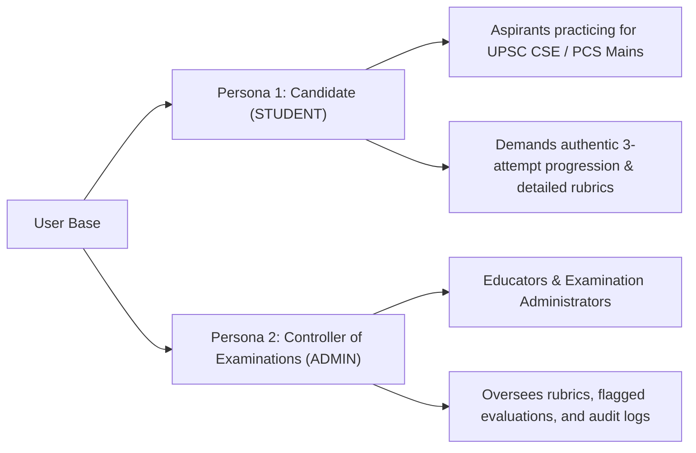
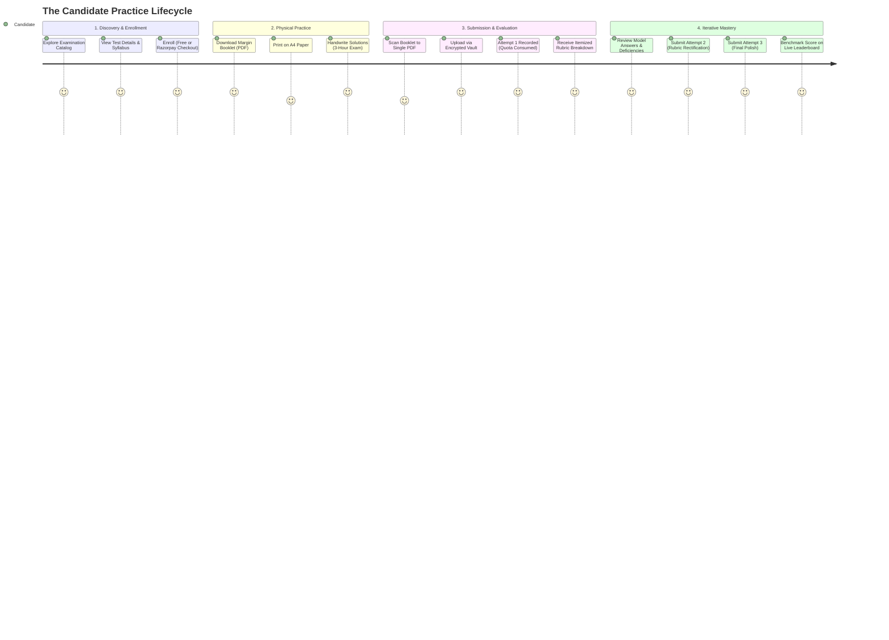

# Verityra — Product Requirements Document (PRD.md)

> **Document Version**: 2.0  
> **Status**: Approved & Implemented  
> **Target Audience**: Product Managers, Software Engineers, AI Agents, Quality Assurance  
> **Work Directory**: `verityra4/`

---

## 1. Product Vision & Problem Statement

### 1.1. Problem Statement
In competitive subjective examinations like the **UPSC Civil Services Examination (CSE) Mains, State Public Service Commissions (State PCS), and Judicial Services Examinations**, scoring is determined entirely by physical, handwritten pen-and-paper articulation:
- **Physical Demands**: Candidates must handwrite 3,000–4,000 words across 20 complex analytical questions within a strict 3-hour limit, observing exact margin boundaries (25mm left, 20mm right) and integrating structured diagrams.
- **Traditional Coaching Bottlenecks**: Offline evaluation institutes take 3 to 5 weeks to return evaluated booklets, offer generic feedback without question-by-question model rubric itemization, and provide no systematic multi-attempt progression.
- **Existing Digital Limitations**: Generic test platforms rely on typed digital inputs, destroying the authentic muscle memory, pacing, and spatial layout vital for actual exam-hall success.

### 1.2. Product Vision
**Verityra** provides an authentic, high-integrity subjective test-series ecosystem that preserves physical pen-on-paper handwriting while leveraging automated multimodal rubric evaluation and transparent educator governance to deliver **actionable, question-wise rubric feedback within minutes**.

---

## 2. User Personas & Target Roles

### Persona 1: The Mains Aspirant (`Role.STUDENT`)
- **Profile**: Civil Services candidate dedicating 8–12 hours daily to subjective answer writing.
- **Pain Points**: Lacks rapid turnaround on handwritten answers; cannot identify exactly which rubric dimensions (keywords, flow, constitutional articles) lost partial marks.
- **Goals**: Download printable margin-aligned A4 booklets; upload single-PDF scans; receive itemized question-by-question rubric scores across three progressive attempts; benchmark rank against competitors.

### Persona 2: Controller of Examinations / Evaluator (`Role.ADMIN`)
- **Profile**: Senior civil services educator or administrator managing test papers, scoring keys, and evaluation integrity.
- **Pain Points**: Overwhelmed by reviewing thousands of mundane scripts; needs automated first-pass evaluation with reliable escalation of uncertain or ambiguous handwriting.
- **Goals**: Create test series with separate public candidate instructions and confidential grading rubrics; review scripts flagged with evaluation uncertainty; adjust scores with mandatory audit logging; grant audited extra attempts when justified.

---

## 3. Product Architecture & User Journey Workflows

---

## 4. Detailed Functional Specifications

### 4.1. Module 1: Public Marketing & Examination Catalog
- **Landing Page ([`app/page.tsx`](file:///d:/Abdul%20Basit/Freelance/Verityra/verityra4/app/page.tsx))**:
  - Pixel-perfect SaaS hero section with authentic examination mockup showing authentic UPSC ruled sheet, 25mm red margins, handwritten response simulation, and live rubric scorecard.
  - 4-Phase Exam Routine explainer (Download $\rightarrow$ Handwrite $\rightarrow$ Scan $\rightarrow$ Rectify).
  - Three-Attempt Guarantee feature breakdown.
  - `shadcn/ui` Accordion FAQ answering handwriting, margin sheet, and attempt policy queries.
  - **Invariant #1**: Absolutely zero mention of "AI", "automated grading", or "machine evaluation" on public marketing surfaces.
- **Examination Catalog ([`app/tests/page.tsx`](file:///d:/Abdul%20Basit/Freelance/Verityra/verityra4/app/tests/page.tsx))**:
  - Categorized list of published subjective test series (Civil Services, State PCS, Judicial Services).
  - Test card attributes: duration, total marks, maximum attempts (3), price in INR (or Free badge).
- **Public Leaderboard ([`app/leaderboard/page.tsx`](file:///d:/Abdul%20Basit/Freelance/Verityra/verityra4/app/leaderboard/page.tsx))**:
  - Transparent competitive rankings computed strictly from finalized, published evaluations.
  - Deterministic tie-breaking by earliest submission timestamp.
  - Displays Candidate Name, Test Module, Awarded Score, Percentage, and Attempt Number used.

### 4.2. Module 2: Authentication & Account Security
- **Registration ([`app/signup/page.tsx`](file:///d:/Abdul%20Basit/Freelance/Verityra/verityra4/app/signup/page.tsx))**:
  - Self-service candidate signup enforced with `Role.STUDENT`.
  - Password strength verification: $\ge 8$ characters, at least 1 uppercase letter, 1 number, and 1 special character.
- **Sign In & OAuth ([`app/signin/page.tsx`](file:///d:/Abdul%20Basit/Freelance/Verityra/verityra4/app/signin/page.tsx))**:
  - Credentials login + Google OAuth login.
  - Automatic redirect based on role: `Role.ADMIN` $\rightarrow$ `/admin`; `Role.STUDENT` $\rightarrow$ `/student/dashboard`.
- **Password Reset ([`app/forgot-password/page.tsx`](file:///d:/Abdul%20Basit/Freelance/Verityra/verityra4/app/forgot-password/page.tsx))**:
  - Secure token generation with SHA-256 hash storage and 60-minute expiry; zero email enumeration leaks.

### 4.3. Module 3: Candidate Portal & Test Workspace
- **Dashboard ([`app/student/dashboard/page.tsx`](file:///d:/Abdul%20Basit/Freelance/Verityra/verityra4/app/student/dashboard/page.tsx))**:
  - Divided KPI strip: `Enrolled Test Series`, `Attempts Evaluated`, `Attempts Remaining`.
  - Tabbed `<DataTable />` views for **Enrolled Test Series** and **Submission History** with search, sorting, and pagination.
- **Test Workspace ([`app/student/tests/[id]/page.tsx`](file:///d:/Abdul%20Basit/Freelance/Verityra/verityra4/app/student/tests/%5Bid%5D/page.tsx))**:
  - 3-Attempt visual quota progress bar.
  - Download official question paper PDF and printable margin-aligned booklet template.
  - Multi-tab examination workspace:
    - **Tab 1 (Evaluated Attempts)**: Itemized question-by-question scoring table with expandable feedback, missing keywords, and structural flow marks.
    - **Tab 2 (Upload Booklet)**: Single-PDF drag-and-drop submission vault with `useConfirm()` protection before burning an attempt slot.
    - **Tab 3 (Instructions & Templates)**: Official student instructions and downloadable margin templates.
- **Candidate Profile & Settings ([`app/student/profile/page.tsx`](file:///d:/Abdul%20Basit/Freelance/Verityra/verityra4/app/student/profile/page.tsx))**:
  - Tabbed settings for Academic Focus (Target exam, institution, phone, bio), Security (Change password with criteria validation), and Three-Attempt Invariant review.

### 4.4. Module 4: Administrator Console
- **Overview Dashboard ([`app/admin/page.tsx`](file:///d:/Abdul%20Basit/Freelance/Verityra/verityra4/app/admin/page.tsx))**:
  - Divided 4-metric KPI strip: `Total Candidates`, `Active Enrollments`, `Pending Reviews`, `Verified Revenue`.
  - Tabbed `<DataTable />` for **Recent Submissions** and **Immutable Audit Logs**.
- **Test Series Management ([`app/admin/test-series/page.tsx`](file:///d:/Abdul%20Basit/Freelance/Verityra/verityra4/app/admin/test-series/page.tsx))**:
  - Create and edit test series with publication toggles and pricing settings.
  - Dedicated inputs for public `studentInstructions` and confidential `privateEvaluationInstructions`.
  - Paper and template PDF upload management.
- **Submissions Queue & Review ([`app/admin/submissions/page.tsx`](file:///d:/Abdul%20Basit/Freelance/Verityra/verityra4/app/admin/submissions/page.tsx))**:
  - Full queue with uncertainty filter to isolate scripts requiring educator review.
  - Score adjustment editor (`/admin/submissions/[id]`): Adjust question marks with live validation ($[0, \text{maxMarks}]$), add educator notes, and commit changes to the audit log.
- **Candidate Overrides ([`app/admin/students/page.tsx`](file:///d:/Abdul%20Basit/Freelance/Verityra/verityra4/app/admin/students/page.tsx))**:
  - Monitor candidate attempt usage.
  - Audited extra attempt dialog to grant additional submissions with mandatory justification notes.
- **Admin Profile & Settings ([`app/admin/profile/page.tsx`](file:///d:/Abdul%20Basit/Freelance/Verityra/verityra4/app/admin/profile/page.tsx))**:
  - Identity management, escalation phone, security credential update, and platform invariant references.

### 4.5. Module 5: Payment Processing & Order Verification
- **Razorpay Server Workflow**:
  - Server-created orders in INR currency.
  - Digital HMAC SHA-256 signature verification in `verifyPaymentAndEnrollAction`.
  - Automatic enrollment record creation upon payment capture.
  - Webhook listener for asynchronous reconciliation.

---

## 5. Non-Functional Requirements (NFRs)

| Dimension | Specification | Verification Mechanism |
|---|---|---|
| **Security: Instruction Confidentiality** | `privateEvaluationInstructions` must never appear in student network payloads or client bundles. | Tested via `Security: Private evaluation instructions are isolated...` in `verityra.test.ts`. |
| **Security: Quota Atomicity** | Strict 3-attempt limit must withstand concurrent browser submissions. | Schema constraint `@@unique([registrationId, attemptNumber])` + transactional verification. |
| **Performance: Server Rendering** | Server Component TTFB $< 300\text{ms}$ on broadband connections. | Edge-ready Server Actions and Turbopack bundle optimization. |
| **Evaluation Latency** | Full 20-question multi-page PDF evaluation completed in $< 45\text{s}$. | Streaming multimodal parsing via Google Gemini 2.5 Flash. |
| **Accessibility (a11y)** | WCAG AA compliance across both Light and Dark themes. | Accessible `@base-ui/react` primitives, visible focus rings, $\ge 4.5:1$ text contrast. |
| **Reliability: Zero Attempt Burn** | Corrupt files or disconnected uploads must never consume an attempt. | Pre-storage file validation; atomic transaction rollback on upload failure. |

---

## 6. Success Metrics & Key Performance Indicators (KPIs)

1. **Attempt Utilization Rate**: $\ge 80\%$ of enrolled candidates utilize at least 2 attempts to iterate on feedback.
2. **Score Improvement Delta**: Candidates who submit Attempt 2 and Attempt 3 demonstrate an average score improvement of $\ge +14\%$.
3. **Turnaround Velocity**: Automated evaluations delivered in $< 3\text{ minutes}$ from candidate PDF upload.
4. **Audit Integrity**: $100\%$ of score overrides and attempt adjustments logged with administrator ID, timestamp, and justification.
